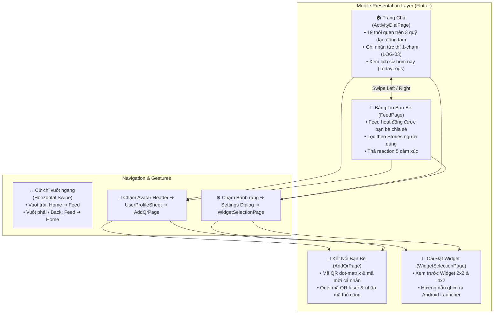
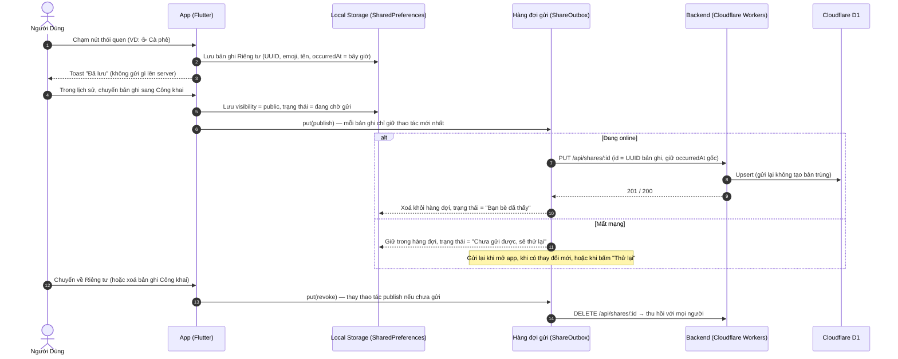

# Hướng Dẫn Sử Dụng Ứng Dụng & Bản Đồ Định Tuyến Backend (Chăm App Usage & Backend Routing Guide)

Tài liệu này cung cấp hướng dẫn hoàn chỉnh về:
1. **Cách sử dụng ứng dụng Chăm** (User Guide & Onboarding).
2. **Kiến trúc điều hướng & tương tác giữa các màn hình** (Screen Navigation & Transitions).
3. **Cơ chế hoạt động ngoại tuyến & đồng bộ** (Offline-First, Outbox Queue & Realtime WebSocket).
4. **Bản đồ định tuyến & đặc tả kỹ thuật API Backend** (Cloudflare Workers & D1 Database).
5. **Hướng dẫn khởi chạy & kết nối toàn hệ thống** (Step-by-step Setup & Run Guide).

---

## 🧭 1. Kiến Trúc Màn Hình & Luồng Tương Tác (Screen Architecture & Transitions)

Ứng dụng **Chăm** được thiết kế theo triết lý tối giản, thao tác nhanh 1-chạm (One-tap logging), loại bỏ mọi form nhập liệu rườm rà.



---

## 📱 2. Hướng Dẫn Sử Dụng Chi Tiết Từng Màn Hình (Screen-by-Screen User Guide)

### 2.1. Màn Hình Chính — Vòng Xoay Quỹ Đạo Thói Quen (Activity Dial Screen)
* **Khái niệm quỹ đạo đồng tâm (Concentric Orbits):** Lấy cảm hứng từ giao diện đồng hồ thông minh (Wear OS Dial), 19 thói quen sinh hoạt được phân bổ khoa học quanh tâm `+ CHẤM`:
  * **Quỹ đạo trong (R1 - Tần suất cao):** `☕ Cà phê`, `💧 Nước`, `🏃 Chạy bộ`, `🍽️ Ăn uống`, `🎯 Tập trung`, `📖 Đọc sách`.
  * **Quỹ đạo giữa (R2 - Sinh hoạt thường nhật):** `🧘 Thiền`, `🚶 Đi dạo`, `😴 Ngủ`, `🧹 Dọn dẹp`, `🎵 Nghe nhạc`, `🐶 Thú cưng`.
  * **Quỹ đạo ngoài (R3 - Hoạt động thể chất & đời sống):** `🍳 Nấu ăn`, `🪴 Tưới cây`, `🏋️ Gym`, `🎬 Xem phim`, `📝 Nhật ký`, `🛒 Mua sắm`, `🚴 Đạp xe`.
* **Ghi nhận 1-chạm (LOG-03):** Chạm trực tiếp vào bất kỳ nút nào $\rightarrow$ nút nảy hiệu ứng (scale bounce animation) $\rightarrow$ xuất hiện Toast `Đã chấm: [Tên] (+1 chấm) — Đã lưu`. Không có form nhập liệu hay bước xác nhận trung gian.
* **Thẻ banner "HÔM NAY":** Hiển thị thứ trong tuần (kèm câu chúc tích cực: *Thứ Hai tươi mới, Thứ Bảy thảnh thơi...*), huy hiệu số chấm đã ghi trong ngày và chuỗi ngày duy trì liên tục (streak).
* **Xem lại lịch sử & xóa bản ghi (HIS-01, HIS-02, LOG-04):**
  * Chạm vào thẻ banner **"HÔM NAY"**, nút tròn **FAB đen** ở góc dưới phải hoặc nút tâm **`+ CHẤM`** để mở bảng `TodayLogsSheet`.
  * Bảng liệt kê chi tiết từng lần chấm kèm thời gian (giờ Việt Nam, UTC+7).
  * Nhấn biểu tượng thùng rác màu đỏ để xóa bản ghi chấm nhầm (hệ thống tự động trừ số lượng; tuân thủ nguyên tắc không cung cấp Undo). Xoá bản ghi Công khai sẽ thu hồi nó khỏi feed bạn bè.
* **Chia sẻ theo từng bản ghi (SOC-03, SOC-04):**
  * Mọi lần chấm đều bắt đầu ở chế độ **🔒 Riêng tư** — chỉ lưu trên máy, không gửi đi đâu.
  * Trong `TodayLogsSheet`, chạm công tắc **Riêng tư** trên một bản ghi để chuyển sang **🌐 Công khai** → tất cả bạn bè thấy bản ghi đó trong feed. Chạm lại để về Riêng tư (thu hồi).
  * Dòng trạng thái tách "đã lưu trên máy" với trạng thái gửi: *Đang chờ gửi…*, *Bạn bè đã thấy*, *Chưa gửi được, sẽ thử lại*, *Đang thu hồi…*. Khi có lỗi, nút **Thử lại** xuất hiện ở đầu bảng.
  * Lần đầu chuyển sang Công khai, app tự tạo tài khoản ẩn danh (cần mạng).

---

### 2.2. Bảng Tin Xã Hội & Tương Tác Bạn Bè (Social Feed Screen)
* **Cách mở:** Vuốt từ phải sang trái (Swipe Left) trên màn hình chính, hoặc chạm vào icon Bảng tin (`Icons.people_alt_outlined`) trên thanh Header.
* **Dữ liệu:** lấy từ `GET /api/feed` — chỉ các bản ghi **Công khai** của bạn bè hiện tại. Kéo xuống để tải lại. Mất mạng thì hiện thông báo kèm nút **Thử lại**; chưa có bạn bè thì có nút **Mở mã QR**.
* **Thanh lọc bạn bè:** Nằm ở đầu trang, lấy từ `GET /api/friends` (chữ cái đầu của tên làm avatar). Chạm vào ai sẽ lọc bảng tin chỉ hiển thị hoạt động của người đó; chọn `Tất cả` để xem feed chung.
* **Thẻ hoạt động (Feed Card):** tên người đăng, emoji hoạt động ở góc avatar, câu *"Minh Thư đã chấm 🏃 Chạy bộ"*, thời gian tương đối theo giờ Việt Nam (*vừa xong, 15 phút trước, Hôm qua 21:30*).
* **Thả reaction (SOC-05):** 7 reaction giống Facebook — 👍 Thích · ❤️ Yêu thích · 🥰 Thương thương · 😆 Haha · 😮 Wow · 😢 Buồn · 😡 Phẫn nộ, kèm số người đã thả. Mỗi người 1 reaction: chạm để thả, chạm emoji khác để đổi, chạm lại để gỡ. Nếu server từ chối, reaction tự hoàn tác và hiện thông báo.

---

### 2.3. Kết Nối Bạn Bè Qua Mã QR (Add QR & Scanner Screen)
* **Cách mở:** Chạm vào Avatar cá nhân ở góc trên bên phải $\rightarrow$ trong modal hồ sơ chọn **"Mở Mã QR & Quét Bạn Bè"**.
* **Tab "Mã QR của tôi":**
  * Hiển thị mã QR dạng **dot-matrix** thẩm mỹ với các chấm tròn nghệ thuật và logo Chăm ở trung tâm.
  * Hiển thị tên hiển thị và **mã mời thật** của tài khoản (`Mã mời: …`). Lần đầu mở, app tự tạo tài khoản ẩn danh (cần mạng; mất mạng thì có nút **Thử lại**).
  * ⚠️ Hình QR hiện là hình minh hoạ (dot-matrix) sinh từ mã mời, **chưa phải mã QR quét được bằng camera**.
  * Nút **"Chia sẻ ảnh"** / **"Lưu vào máy"**: hiện mới là giao diện (chỉ hiện thông báo), chưa xuất ảnh.
* **Tab "Quét mã QR":**
  * Giao diện ống ngắm máy quét với 4 góc bo sáng và tia laser quét lên xuống.
  * Nút **"Bật đèn" / "Tắt đèn"**, **"Chọn ảnh"**: hiện mới là giao diện, chưa dùng camera / thư viện ảnh.
  * Nút **"Nhập mã"**: nhập mã mời của bạn bè → xác nhận **"Kết bạn"** → gọi `POST /api/friends` → **thành bạn bè ngay** (không cần người kia đồng ý, SOC-01). Feed và danh sách bạn được tải lại; bạn mới thấy được cả các bản Công khai trước đó.

---

### 2.4. Cấu Hình Widget Màn Hình Chính (Home Screen Widgets)
* **Cách mở:** Chạm vào icon Bánh răng `⚙️` trên Header $\rightarrow$ chọn **"Cài đặt Widget (2×2, 4×2)"**.
* **Widget Nhỏ (2×2):** Nút tròn lớn màu cam san hô, cho phép chạm trực tiếp từ màn hình chính điện thoại để ghi nhận thói quen yêu thích trong tích tắc.
* **Widget Vừa (4×2):** Hiển thị tiến độ trong ngày (ví dụ `3/4`), chuỗi streak, và 2 nút thói quen tùy chọn để chấm nhanh.
* **Hướng dẫn ghim widget:** Bấm nút **"Thêm Widget"** để xem hướng dẫn từng bước ghim widget vào Android Launcher.

---

## ⚡ 3. Cơ Chế Local-First & Đồng Bộ Ngoại Tuyến (Offline-First Mechanism)

Hệ thống tuân thủ các yêu cầu **DAT-01, DAT-03, BR-01, BR-02, BR-03, SOC-03, SOC-04**:



### Nguyên tắc đảm bảo tính toàn vẹn:
1. **Riêng tư mặc định:** chạm nút (trong app hay widget) luôn tạo bản ghi Riêng tư; chỉ bản ghi người dùng tự chuyển sang Công khai mới lên server (DAT-01).
2. **Idempotent:** `PUT` và `DELETE /api/shares/:id` dùng chính UUID của bản ghi, nên hàng đợi gửi lại bao nhiêu lần server cũng chỉ có đúng một bản (AC-05). `DELETE` một id không tồn tại vẫn trả `204`.
3. **Ý định cuối cùng thắng:** hàng đợi khoá theo id bản ghi. Chuyển Công khai rồi về Riêng tư khi đang offline → chỉ gửi `DELETE`.
4. **Bảo tồn thời điểm gốc (`occurredAt`):** gửi trễ bao lâu thì bạn bè vẫn thấy đúng giờ chạm nút (BR-02).
5. **Quyền xem (SOC-03, AC-06):** Công khai = tất cả bạn bè **hiện tại** của chủ bản ghi. Không có chọn từng người nhận. Kết bạn mới → thấy cả bản Công khai cũ; huỷ kết bạn → mất quyền ngay, reaction giữa hai người bị xoá.

---

## 🗺️ 4. Đặc Tả Kỹ Thuật & Bản Đồ Định Tuyến API Backend (Backend Routing Specification)

Máy chủ Backend được xây dựng bằng **Hono Framework** chạy trên môi trường serverless **Cloudflare Workers**, kết nối cơ sở dữ liệu phân tán **Cloudflare D1 (SQLite)**.

Tất cả các route ngoại trừ `/api/auth/register` đều yêu cầu xác thực qua Header:
```http
Authorization: Bearer <user_access_token>
```

---

### 4.1. Phân Hệ Xác Thực & Người Dùng (`/api/auth`, `/api/me`)

#### 1. Đăng ký tài khoản ẩn danh (Auto-Registration)
* **Phương thức & URL:** `POST /api/auth/register`
* **Mô tả:** Được gọi tự động ở lần đầu dùng tính năng xã hội (mở feed, mở mã QR, hoặc chuyển một bản ghi sang Công khai). Dùng app offline thì không cần tài khoản.
* **Request Body:**
  ```json
  {
    "displayName": "Bạn"
  }
  ```
* **Response (201 Created):**
  ```json
  {
    "data": {
      "user": {
        "id": "e9a8f3b2-7c1d-4e5f-8a0b-1c2d3e4f5a6b",
        "displayName": "Bạn",
        "inviteCode": "K7M2P9XQ4R",
        "createdAt": "2026-10-25T07:00:00.000Z"
      },
      "token": "tok_sec_9f8e7d6c5b4a3..."
    }
  }
  ```

#### 2. Lấy thông tin tài khoản hiện tại
* **Phương thức & URL:** `GET /api/me`
* **Response (200 OK):**
  ```json
  {
    "data": {
      "id": "e9a8f3b2-7c1d-4e5f-8a0b-1c2d3e4f5a6b",
      "displayName": "Hà My",
      "inviteCode": "K7M2P9XQ4R",
      "createdAt": "2026-10-25T07:00:00.000Z"
    }
  }
  ```

#### 3. Đổi mã mời kết bạn (Xoay QR Code)
* **Phương thức & URL:** `POST /api/me/invite-code`
* **Mô tả:** Tạo mã mời mới và làm mất hiệu lực mã QR cũ để tăng cường quyền riêng tư.
* **Response (200 OK):**
  ```json
  {
    "data": {
      "id": "e9a8f3b2-7c1d-4e5f-8a0b-1c2d3e4f5a6b",
      "displayName": "Hà My",
      "inviteCode": "B3T8WQ2N6M",
      "createdAt": "2026-10-25T07:00:00.000Z"
    }
  }
  ```

#### 4. Kênh thông báo thời gian thực (Realtime WebSocket)
* **Phương thức & URL:** `GET /api/me/ws` hoặc `GET /api/me/ws?token=<token>`
* **Mô tả:** Mở kết nối WebSocket tới Durable Object `UserRoom` để nhận **gợi ý tải lại** (không chứa dữ liệu; dữ liệu luôn lấy qua REST để kiểm tra quyền). App mobile hiện chưa dùng kênh này — feed tải lại khi mở / kéo xuống.
  ```json
  { "type": "share.upserted", "id": "..." }
  { "type": "share.removed", "id": "..." }
  { "type": "reaction.changed", "shareId": "..." }
  { "type": "friends.changed" }
  ```

---

### 4.2. Phân Hệ Bạn Bè & Quét QR (`/api/friends`)

#### 1. Lấy danh sách bạn bè
* **Phương thức & URL:** `GET /api/friends`
* **Mục đích:** Cung cấp danh sách người dùng cho thanh Stories trên Bảng tin.
* **Response (200 OK):**
  ```json
  {
    "data": [
      { "id": "u2-uuid", "displayName": "Minh Thư", "since": "2026-10-20T10:15:00.000Z" },
      { "id": "u3-uuid", "displayName": "Hoàng Long", "since": "2026-10-22T08:30:00.000Z" }
    ]
  }
  ```

#### 2. Kết bạn bằng mã mời (Từ QR hoặc nhập tay)
* **Phương thức & URL:** `POST /api/friends`
* **Request Body:**
  ```json
  {
    "inviteCode": "H4R7N2Q8ZK"
  }
  ```
* **Response:** kết bạn **trực tiếp**, không cần người kia đồng ý (SOC-01).
  * `201 Created`: kết nối bạn bè mới. · `200 OK`: hai người đã là bạn bè trước đó.
  * `404 INVITE_NOT_FOUND`: mã không tồn tại (hoặc đã bị đổi). · `400 CANNOT_FRIEND_SELF`: quét mã của chính mình.
  ```json
  {
    "data": { "id": "u4-uuid", "displayName": "An Nhiên", "since": "2026-10-25T07:30:00.000Z" }
  }
  ```

#### 3. Xóa bạn bè
* **Phương thức & URL:** `DELETE /api/friends/:userId`
* **Response:** `204 No Content` (Hủy quyền xem feed hai chiều; reaction giữa hai người bị xoá).

---

### 4.3. Phân Hệ Đồng Bộ Nhật Ký Chia Sẻ (`/api/shares`)

#### 1. Chuyển bản ghi sang Công khai (Idempotent Upsert)
* **Phương thức & URL:** `PUT /api/shares/:id`
* **Path Parameter:** `:id` là UUID v4 (dạng `xxxxxxxx-xxxx-4xxx-yxxx-xxxxxxxxxxxx`) của bản ghi local.
* **Request Body** (strict — field lạ như `targetIds` bị trả `400`):
  ```json
  {
    "emoji": "☕",
    "name": "Cà phê",
    "occurredAt": "2026-10-25T00:15:00.000Z"
  }
  ```
* **Response (201 tạo mới / 200 cập nhật):** `409` nếu id đã thuộc người khác.
  ```json
  {
    "data": {
      "id": "c1a2b3c4-d5e6-4f8a-9b0c-1d2e3f4a5b6c",
      "emoji": "☕",
      "name": "Cà phê",
      "occurredAt": "2026-10-25T00:15:00.000Z",
      "reactions": [],
      "createdAt": "2026-10-25T00:15:01.000Z",
      "updatedAt": "2026-10-25T00:15:01.000Z"
    }
  }
  ```

#### 2. Về Riêng tư / xoá bản ghi Công khai (thu hồi)
* **Phương thức & URL:** `DELETE /api/shares/:id`
* **Response:** `204 No Content` — gỡ khỏi feed của mọi người bạn, reaction trên đó bị xoá. Id không tồn tại cũng trả `204` để hàng đợi gửi lại an toàn.

---

### 4.4. Phân Hệ Bảng Tin Hoạt Động & Thả Reaction (`/api/feed`)

#### 1. Lấy danh sách bài viết trên Bảng tin bạn bè
* **Phương thức & URL:** `GET /api/feed`
* **Query Parameters:**
  * `cursor`: Con trỏ phân trang từ lần tải trước.
  * `limit`: Số lượng bài viết mỗi trang (mặc định: `20`, tối đa: `50`).
* **Response (200 OK):** chỉ gồm bản ghi Công khai của bạn bè hiện tại, mới nhất trước theo `occurredAt`.
  ```json
  {
    "data": [
      {
        "id": "8f0c2a7e-1b3d-4c5e-9f6a-7b8c9d0e1f2a",
        "owner": { "id": "u2-uuid", "displayName": "Minh Thư" },
        "emoji": "🏃",
        "name": "Chạy bộ",
        "occurredAt": "2026-10-25T00:05:00.000Z",
        "reactions": [
          { "emoji": "❤️", "count": 3 },
          { "emoji": "👍", "count": 1 }
        ],
        "myReaction": "❤️"
      }
    ],
    "nextCursor": "1761350700000_8f0c2a7e-1b3d-4c5e-9f6a-7b8c9d0e1f2a"
  }
  ```

#### 2. Thả hoặc thay đổi biểu tượng cảm xúc (Reaction)
* **Phương thức & URL:** `PUT /api/feed/:id/reaction`
* **Request Body:**
  ```json
  {
    "emoji": "🥰"
  }
  ```
  *(7 emoji hợp lệ: `👍` `❤️` `🥰` `😆` `😮` `😢` `😡`; emoji khác → `400`. Mỗi người 1 reaction, gửi lại = đổi.)*
* **Response (200 OK):** trả về bản ghi trong feed với số đếm mới (cùng dạng phần tử của `GET /api/feed`).

#### 3. Thu hồi cảm xúc (Unreact)
* **Phương thức & URL:** `DELETE /api/feed/:id/reaction`
* **Response:** `204 No Content`.

---

## 🚀 5. Hướng Dẫn Khởi Chạy & Kiểm Thử Toàn Bộ Hệ Thống (Step-by-Step Setup)

### 5.1. Bước 1: Khởi Chạy Máy Chủ Backend (Cloudflare Workers)

1. Mở terminal tại thư mục gốc của repository, chuyển vào thư mục `backend`:
   ```bash
   cd backend
   npm install
   ```
2. Khởi tạo và áp dụng migrations vào cơ sở dữ liệu Cloudflare D1 cục bộ:
   ```bash
   npx wrangler d1 migrations apply cham-db --local
   ```
3. Bật máy chủ phát triển Backend:
   ```bash
   npm run dev
   ```
   *Máy chủ API sẽ hoạt động tại:* `http://localhost:8787`  
   *Kiểm tra trạng thái:* Mở trình duyệt truy cập `http://localhost:8787/health` $\rightarrow$ nhận `{ "status": "ok" }`.

---

### 5.2. Bước 2: Khởi Chạy Ứng Dụng Mobile Flutter

1. Mở cửa sổ terminal thứ 2, chuyển vào thư mục `mobile`:
   ```bash
   cd mobile
   flutter pub get
   ```
2. Cấu hình biến môi trường kết nối:  
   Tệp [`mobile/env/dev.json`](file:///c:/Users/admin/StudioProjects/Cham-ActivityLogWithPeople/mobile/env/dev.json) đã được thiết lập sẵn:
   ```json
   {
     "APP_ENV": "dev",
     "API_BASE_URL": "http://localhost:8787"
   }
   ```
   > [!TIP]
   > Lớp [`Env`](file:///c:/Users/admin/StudioProjects/Cham-ActivityLogWithPeople/mobile/lib/core/config/env.dart) tự động nhận diện thiết bị. Nếu bạn chạy trên **Android Emulator**, địa chỉ `localhost` sẽ được tự động ánh xạ thành `10.0.2.2:8787` mà không cần sửa code.

3. Chạy ứng dụng:
   ```bash
   # Chạy trên máy ảo / thiết bị thật
   flutter run --dart-define-from-file=env/dev.json

   # Hoặc chạy trên trình duyệt Chrome để test nhanh giao diện
   flutter run -d chrome --dart-define-from-file=env/dev.json
   ```

---

### 5.3. Bước 3: Chạy Bộ Kiểm Thử Tự Động (Test Suite)

Để kiểm tra toàn bộ luồng nghiệp vụ, giao diện, cử chỉ vuốt và các tương tác:

```bash
# Trong thư mục mobile
flutter test
```

Kết quả kỳ vọng: **All tests passed!** Danh sách test và phạm vi: xem [`workflow_testing.md`](workflow_testing.md).

Backend: `cd backend && npm test` (chạy trong Workers runtime, tự áp migration lên DB tạm).
