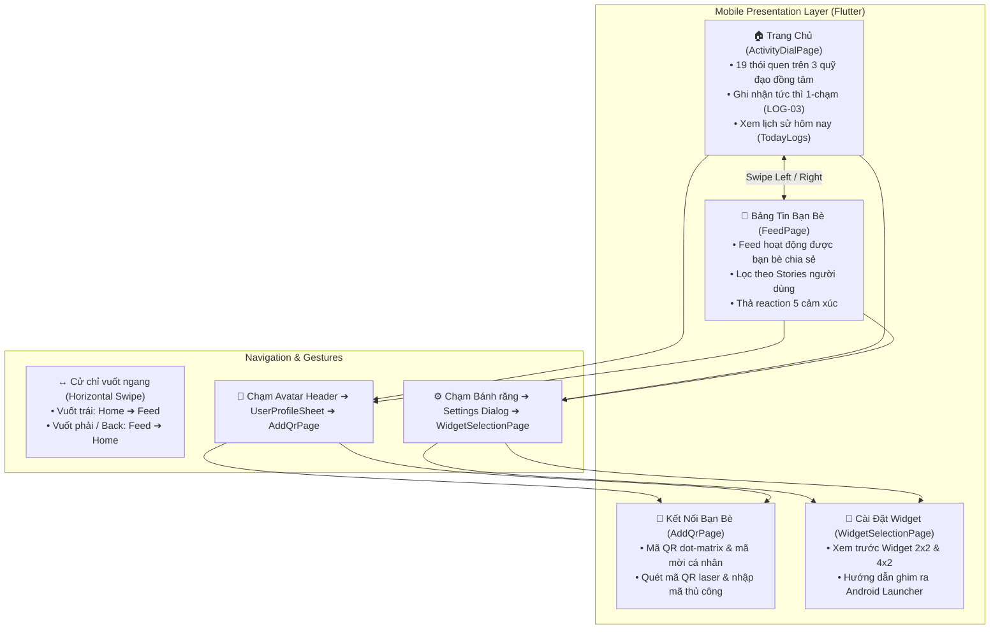
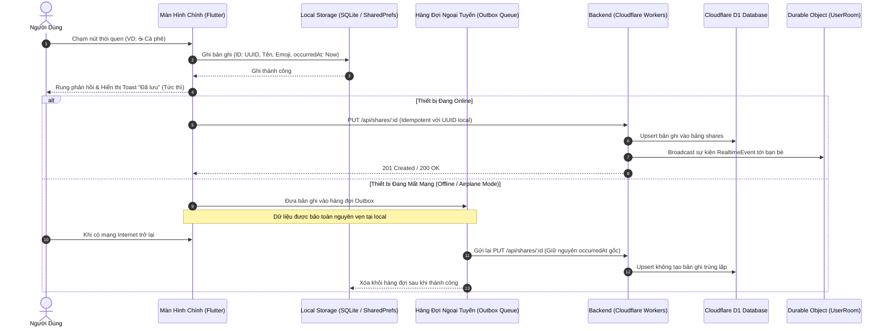

# Hướng Dẫn Sử Dụng Ứng Dụng & Bản Đồ Định Tuyến Backend (Chăm App Usage & Backend Routing Guide)

Tài liệu này cung cấp hướng dẫn hoàn chỉnh về:
1. **Cách sử dụng ứng dụng Chăm** (User Guide & Onboarding).
2. **Kiến trúc điều hướng & tương tác giữa các màn hình** (Screen Navigation & Transitions).
3. **Cơ chế hoạt động ngoại tuyến & đồng bộ** (Offline-First, Outbox Queue & Realtime WebSocket).
4. **Bản đồ định tuyến & đặc tả kỹ thuật API Backend** (Cloudflare Workers & D1 Database).
5. **Hướng dẫn khởi chạy & kết nối toàn hệ thống** (Step-by-step Setup & Run Guide).

---

## 🧭 1. Kiến Trúc Màn Hình & Luồng Tương Tác (Screen Architecture & Transitions)

Ứng dụng **Chăm** được thiết kế theo triết lý tối giản, thao tác nhanh 1-chạm (One-tap logging), loại bỏ mọi form nhập liệu rườm rà.



---

## 📱 2. Hướng Dẫn Sử Dụng Chi Tiết Từng Màn Hình (Screen-by-Screen User Guide)

### 2.1. Màn Hình Chính — Vòng Xoay Quỹ Đạo Thói Quen (Activity Dial Screen)
* **Khái niệm quỹ đạo đồng tâm (Concentric Orbits):** Lấy cảm hứng từ giao diện đồng hồ thông minh (Wear OS Dial), 19 thói quen sinh hoạt được phân bổ khoa học quanh tâm `+ CHẤM`:
  * **Quỹ đạo trong (R1 - Tần suất cao):** `☕ Cà phê`, `💧 Nước`, `🏃 Chạy bộ`, `🍽️ Ăn uống`, `🎯 Tập trung`, `📖 Đọc sách`.
  * **Quỹ đạo giữa (R2 - Sinh hoạt thường nhật):** `🧘 Thiền`, `🚶 Đi dạo`, `😴 Ngủ`, `🧹 Dọn dẹp`, `🎵 Nghe nhạc`, `🐶 Thú cưng`.
  * **Quỹ đạo ngoài (R3 - Hoạt động thể chất & đời sống):** `🍳 Nấu ăn`, `🪴 Tưới cây`, `🏋️ Gym`, `🎬 Xem phim`, `📝 Nhật ký`, `🛒 Mua sắm`, `🚴 Đạp xe`.
* **Ghi nhận 1-chạm (LOG-03):** Chạm trực tiếp vào bất kỳ nút nào $\rightarrow$ nút nảy hiệu ứng (scale bounce animation) $\rightarrow$ xuất hiện Toast `Đã chấm: [Tên] (+1 chấm) — Đã lưu`. Không có form nhập liệu hay bước xác nhận trung gian.
* **Thẻ banner "HÔM NAY":** Hiển thị thứ trong tuần (kèm câu chúc tích cực: *Thứ Hai tươi mới, Thứ Bảy thảnh thơi...*), huy hiệu số chấm đã ghi trong ngày và chuỗi ngày duy trì liên tục (streak).
* **Xem lại lịch sử & xóa bản ghi (HIS-01, HIS-02, LOG-04):**
  * Chạm vào thẻ banner **"HÔM NAY"**, nút tròn **FAB đen** ở góc dưới phải hoặc nút tâm **`+ CHẤM`** để mở bảng `TodayLogsSheet`.
  * Bảng liệt kê chi tiết từng lần chấm kèm thời gian chính xác.
  * Nhấn biểu tượng thùng rác màu đỏ để xóa bản ghi chấm nhầm (hệ thống tự động trừ số lượng; tuân thủ nguyên tắc không cung cấp Undo).

---

### 2.2. Bảng Tin Xã Hội & Tương Tác Bạn Bè (Social Feed Screen)
* **Cách mở:** Vuốt từ phải sang trái (Swipe Left) trên màn hình chính, hoặc chạm vào icon Bảng tin (`Icons.people_alt_outlined`) trên thanh Header.
* **Thanh Stories bạn bè:** Nằm ở đầu trang, hiển thị avatar của bạn bè đang kết nối. Chạm vào avatar của ai sẽ lọc bảng tin chỉ hiển thị hoạt động của người đó; chọn `Tất cả` để xem feed chung.
* **Thẻ hoạt động (Feed Card):** Hiển thị avatar người đăng, huy hiệu thói quen, câu mô tả hành động (ví dụ: *Minh Thư đã hoàn thành chạy bộ 5km*), thời gian tương đối (*vừa xong, 15 phút trước*).
* **Thả biểu tượng cảm xúc (Reactions):** Dải nút 5 cảm xúc trực quan (`❤️`, `👍`, `😊`, `😢`, `😆`). Chạm vào biểu tượng để thả cảm xúc (nền đổi sang màu hồng nổi bật); chạm lại để thu hồi.

---

### 2.3. Kết Nối Bạn Bè Qua Mã QR (Add QR & Scanner Screen)
* **Cách mở:** Chạm vào Avatar cá nhân ở góc trên bên phải $\rightarrow$ trong modal hồ sơ chọn **"Mở Mã QR & Quét Bạn Bè"**.
* **Tab "Mã QR của tôi":**
  * Hiển thị mã QR dạng **dot-matrix** thẩm mỹ với các chấm tròn nghệ thuật và logo Chăm ở trung tâm.
  * Hiển thị tên hiển thị, username (`@hamy_cham`), mã mời (`CHAM-XXXXXX`).
  * Nút **"Chia sẻ ảnh"**: Xuất file ảnh mã QR kèm khung trang trí để gửi qua mạng xã hội, tin nhắn.
  * Nút **"Lưu vào máy"**: Tải trực tiếp ảnh mã QR vào thư viện ảnh thiết bị.
* **Tab "Quét mã QR":**
  * Giao diện ống ngắm máy quét với 4 góc bo sáng và tia laser quét lên xuống.
  * Nút **"Bật đèn" / "Tắt đèn"**: Bật đèn flash khi quét trong môi trường tối.
  * Nút **"Chọn ảnh"**: Quét mã QR từ ảnh có sẵn trong thư viện.
  * Nút **"Nhập mã"**: Nhập thủ công mã mời bạn bè 6–8 ký tự để kết bạn mà không cần camera.

---

### 2.4. Cấu Hình Widget Màn Hình Chính (Home Screen Widgets)
* **Cách mở:** Chạm vào icon Bánh răng `⚙️` trên Header $\rightarrow$ chọn **"Cài đặt Widget (2×2, 4×2)"**.
* **Widget Nhỏ (2×2):** Nút tròn lớn màu cam san hô, cho phép chạm trực tiếp từ màn hình chính điện thoại để ghi nhận thói quen yêu thích trong tích tắc.
* **Widget Vừa (4×2):** Hiển thị tiến độ trong ngày (ví dụ `3/4`), chuỗi streak, và 2 nút thói quen tùy chọn để chấm nhanh.
* **Hướng dẫn ghim widget:** Bấm nút **"Thêm Widget"** để xem hướng dẫn từng bước ghim widget vào Android Launcher.

---

## ⚡ 3. Cơ Chế Local-First & Đồng Bộ Ngoại Tuyến (Offline-First Mechanism)

Hệ thống tuân thủ nghiêm ngặt các yêu cầu **DAT-01, DAT-03, BR-01, BR-02**:



### Nguyên tắc đảm bảo tính toàn vẹn:
1. **Idempotent PUT Requests:** API chia sẻ sử dụng chính UUID tạo ra từ local làm định danh URL: `PUT /api/shares/:id`. Dù hàng đợi gửi lại nhiều lần do mạng chập chờn, server vẫn chỉ lưu đúng 1 bản ghi duy nhất (`DAT-03`).
2. **Bảo tồn thời điểm gốc (`occurredAt`):** Dù bản ghi được đồng bộ trễ nhiều giờ sau khi người dùng kết nối mạng lại, thời gian hiển thị trên bảng tin bạn bè vẫn là thời điểm thực tế lúc người dùng chạm nút (`BR-02`).
3. **Quyền xem Broadcast & Multicast (SOC-03, AC-06):**
   * Mặc định `targetIds: null` $\rightarrow$ Broadcast cho tất cả bạn bè đang có.
   * Khi chọn danh sách `targetIds: ['user-id-1', 'user-id-2']` $\rightarrow$ Multicast, chỉ người trong danh sách mới có quyền xem hoạt động.

---

## 🗺️ 4. Đặc Tả Kỹ Thuật & Bản Đồ Định Tuyến API Backend (Backend Routing Specification)

Máy chủ Backend được xây dựng bằng **Hono Framework** chạy trên môi trường serverless **Cloudflare Workers**, kết nối cơ sở dữ liệu phân tán **Cloudflare D1 (SQLite)**.

Tất cả các route ngoại trừ `/api/auth/register` đều yêu cầu xác thực qua Header:
```http
Authorization: Bearer <user_access_token>
```

---

### 4.1. Phân Hệ Xác Thực & Người Dùng (`/api/auth`, `/api/me`)

#### 1. Đăng ký tài khoản ẩn danh (Auto-Registration)
* **Phương thức & URL:** `POST /api/auth/register`
* **Mô tả:** Được gọi tự động trong lần đầu tiên mở ứng dụng để cấp danh tính ẩn danh.
* **Request Body:**
  ```json
  {
    "displayName": "Bạn"
  }
  ```
* **Response (201 Created):**
  ```json
  {
    "data": {
      "user": {
        "id": "e9a8f3b2-7c1d-4e5f-8a0b-1c2d3e4f5a6b",
        "displayName": "Bạn",
        "inviteCode": "CHAM-7K9M2P",
        "createdAt": "2026-10-25T07:00:00.000Z"
      },
      "token": "tok_sec_9f8e7d6c5b4a3..."
    }
  }
  ```

#### 2. Lấy thông tin tài khoản hiện tại
* **Phương thức & URL:** `GET /api/me`
* **Response (200 OK):**
  ```json
  {
    "data": {
      "id": "e9a8f3b2-7c1d-4e5f-8a0b-1c2d3e4f5a6b",
      "displayName": "Hà My",
      "inviteCode": "CHAM-7K9M2P",
      "createdAt": "2026-10-25T07:00:00.000Z"
    }
  }
  ```

#### 3. Đổi mã mời kết bạn (Xoay QR Code)
* **Phương thức & URL:** `POST /api/me/invite-code`
* **Mô tả:** Tạo mã mời mới và làm mất hiệu lực mã QR cũ để tăng cường quyền riêng tư.
* **Response (200 OK):**
  ```json
  {
    "data": {
      "id": "e9a8f3b2-7c1d-4e5f-8a0b-1c2d3e4f5a6b",
      "displayName": "Hà My",
      "inviteCode": "CHAM-9X2L8Q",
      "createdAt": "2026-10-25T07:00:00.000Z"
    }
  }
  ```

#### 4. Kênh thông báo thời gian thực (Realtime WebSocket)
* **Phương thức & URL:** `GET /api/me/ws` hoặc `GET /api/me/ws?token=<token>`
* **Mô tả:** Mở kết nối WebSocket tới Durable Object (`UserRoomDO`) để nhận các gợi ý cập nhật:
  ```json
  { "type": "friend_added", "friendId": "..." }
  { "type": "feed_updated", "shareId": "..." }
  { "type": "reaction_added", "shareId": "...", "emoji": "❤️" }
  ```

---

### 4.2. Phân Hệ Bạn Bè & Quét QR (`/api/friends`)

#### 1. Lấy danh sách bạn bè
* **Phương thức & URL:** `GET /api/friends`
* **Mục đích:** Cung cấp danh sách người dùng cho thanh Stories trên Bảng tin.
* **Response (200 OK):**
  ```json
  {
    "data": [
      {
        "id": "u2-uuid",
        "displayName": "Minh Thư",
        "avatarUrl": "https://images.unsplash.com/photo-1517841905240-472988babdf9?w=150",
        "createdAt": "2026-10-20T10:15:00.000Z"
      },
      {
        "id": "u3-uuid",
        "displayName": "Hoàng Long",
        "avatarUrl": "https://images.unsplash.com/photo-1507003211169-0a1dd7228f2d?w=150",
        "createdAt": "2026-10-22T08:30:00.000Z"
      }
    ]
  }
  ```

#### 2. Kết bạn bằng mã mời (Từ QR hoặc nhập tay)
* **Phương thức & URL:** `POST /api/friends`
* **Request Body:**
  ```json
  {
    "inviteCode": "CHAM-8F3K9M"
  }
  ```
* **Response:**
  * `201 Created`: Nếu đây là kết nối bạn bè mới.
  * `200 OK`: Nếu hai người dùng đã là bạn bè trước đó.
  ```json
  {
    "data": {
      "id": "u4-uuid",
      "displayName": "An Nhiên",
      "createdAt": "2026-10-25T07:30:00.000Z"
    }
  }
  ```

#### 3. Xóa bạn bè
* **Phương thức & URL:** `DELETE /api/friends/:userId`
* **Response:** `204 No Content` (Hủy quyền xem feed hai chiều).

---

### 4.3. Phân Hệ Đồng Bộ Nhật Ký Chia Sẻ (`/api/shares`)

#### 1. Gửi bản ghi chia sẻ lên hệ thống (Idempotent Upsert)
* **Phương thức & URL:** `PUT /api/shares/:id`
* **Path Parameter:** `:id` là UUID của bản ghi được tạo ra từ ứng dụng local.
* **Request Body:**
  ```json
  {
    "emoji": "☕",
    "name": "Cà phê sáng",
    "occurredAt": "2026-10-25T07:15:00.000Z",
    "targetIds": null
  }
  ```
  *(Ghi chú: `targetIds: null` hoặc `[]` là broadcast cho tất cả bạn bè; truyền mảng `['id1', 'id2']` để áp dụng multicast).*
* **Response (201 Created / 200 OK):**
  ```json
  {
    "data": {
      "id": "c1a2b3c4-d5e6-7f8a-9b0c-1d2e3f4a5b6c",
      "userId": "e9a8f3b2-7c1d-4e5f-8a0b-1c2d3e4f5a6b",
      "emoji": "☕",
      "name": "Cà phê sáng",
      "occurredAt": "2026-10-25T07:15:00.000Z",
      "targetIds": null,
      "createdAt": "2026-10-25T07:15:01.000Z"
    }
  }
  ```

#### 2. Xóa bản ghi đã chia sẻ
* **Phương thức & URL:** `DELETE /api/shares/:id`
* **Response:** `204 No Content` (Bản ghi bị gỡ bỏ khỏi bảng tin của bạn bè).

---

### 4.4. Phân Hệ Bảng Tin Hoạt Động & Thả Reaction (`/api/feed`)

#### 1. Lấy danh sách bài viết trên Bảng tin bạn bè
* **Phương thức & URL:** `GET /api/feed`
* **Query Parameters:**
  * `cursor`: Con trỏ phân trang từ lần tải trước.
  * `limit`: Số lượng bài viết mỗi trang (mặc định: `20`, tối đa: `50`).
* **Response (200 OK):**
  ```json
  {
    "data": [
      {
        "id": "share-uuid-1",
        "userId": "u2-uuid",
        "userName": "Minh Thư",
        "userAvatar": "https://images.unsplash.com/photo-1517841905240-472988babdf9?w=150",
        "emoji": "🏃",
        "name": "đã hoàn thành chạy bộ 5km",
        "occurredAt": "2026-10-25T07:05:00.000Z",
        "myReaction": "❤️",
        "reactionsCount": {
          "❤️": 3,
          "👍": 1
        }
      }
    ],
    "nextCursor": "1730000000000_share-uuid-1"
  }
  ```

#### 2. Thả hoặc thay đổi biểu tượng cảm xúc (Reaction)
* **Phương thức & URL:** `PUT /api/feed/:id/reaction`
* **Request Body:**
  ```json
  {
    "emoji": "❤️"
  }
  ```
  *(Các emoji hợp lệ: `❤️`, `😂`, `😮`, `😢`, `👍`, `🔥`)*
* **Response (200 OK):**
  ```json
  {
    "data": {
      "shareId": "share-uuid-1",
      "userId": "e9a8f3b2-7c1d-4e5f-8a0b-1c2d3e4f5a6b",
      "emoji": "❤️",
      "updatedAt": "2026-10-25T07:20:00.000Z"
    }
  }
  ```

#### 3. Thu hồi cảm xúc (Unreact)
* **Phương thức & URL:** `DELETE /api/feed/:id/reaction`
* **Response:** `204 No Content`.

---

## 🚀 5. Hướng Dẫn Khởi Chạy & Kiểm Thử Toàn Bộ Hệ Thống (Step-by-Step Setup)

### 5.1. Bước 1: Khởi Chạy Máy Chủ Backend (Cloudflare Workers)

1. Mở terminal tại thư mục gốc của repository, chuyển vào thư mục `backend`:
   ```bash
   cd backend
   npm install
   ```
2. Khởi tạo và áp dụng migrations vào cơ sở dữ liệu Cloudflare D1 cục bộ:
   ```bash
   npx wrangler d1 migrations apply cham-db --local
   ```
3. Bật máy chủ phát triển Backend:
   ```bash
   npm run dev
   ```
   *Máy chủ API sẽ hoạt động tại:* `http://localhost:8787`  
   *Kiểm tra trạng thái:* Mở trình duyệt truy cập `http://localhost:8787/health` $\rightarrow$ nhận `{ "status": "ok" }`.

---

### 5.2. Bước 2: Khởi Chạy Ứng Dụng Mobile Flutter

1. Mở cửa sổ terminal thứ 2, chuyển vào thư mục `mobile`:
   ```bash
   cd mobile
   flutter pub get
   ```
2. Cấu hình biến môi trường kết nối:  
   Tệp [`mobile/env/dev.json`](file:///c:/Users/admin/StudioProjects/Cham-ActivityLogWithPeople/mobile/env/dev.json) đã được thiết lập sẵn:
   ```json
   {
     "APP_ENV": "dev",
     "API_BASE_URL": "http://localhost:8787"
   }
   ```
   > [!TIP]
   > Lớp [`Env`](file:///c:/Users/admin/StudioProjects/Cham-ActivityLogWithPeople/mobile/lib/core/config/env.dart) tự động nhận diện thiết bị. Nếu bạn chạy trên **Android Emulator**, địa chỉ `localhost` sẽ được tự động ánh xạ thành `10.0.2.2:8787` mà không cần sửa code.

3. Chạy ứng dụng:
   ```bash
   # Chạy trên máy ảo / thiết bị thật
   flutter run --dart-define-from-file=env/dev.json

   # Hoặc chạy trên trình duyệt Chrome để test nhanh giao diện
   flutter run -d chrome --dart-define-from-file=env/dev.json
   ```

---

### 5.3. Bước 3: Chạy Bộ Kiểm Thử Tự Động (Test Suite)

Để kiểm tra toàn bộ luồng nghiệp vụ, giao diện, cử chỉ vuốt và các tương tác:

```bash
# Trong thư mục mobile
flutter test
```

Kết quả kỳ vọng: **All tests passed!** (Bao gồm `main_navigation_test.dart`, `activity_dial_test.dart`, `add_qr_test.dart`, `widget_selection_test.dart`, `todo_test.dart`).
