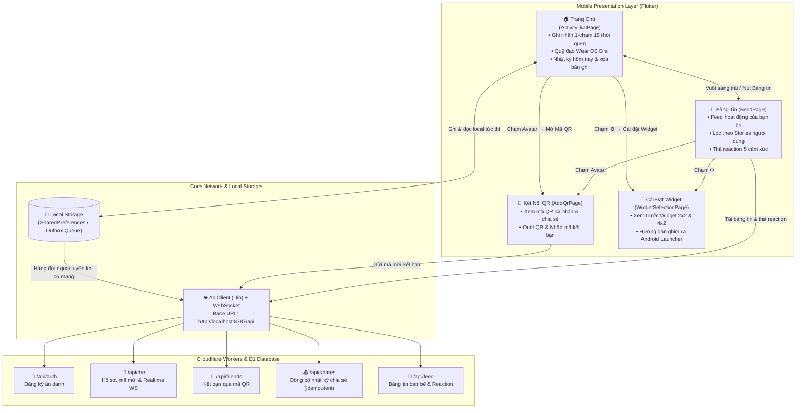

# Hướng Dẫn Sử Dụng Ứng Dụng & Bản Đồ Định Tuyến Backend (App Usage & Backend Routing Guide)

Tài liệu này cung cấp hướng dẫn toàn diện về **cách sử dụng ứng dụng Chăm**, cơ chế **Local-First / Đồng bộ ngoại tuyến**, và **bản đồ kết nối định tuyến API Backend** từ ứng dụng di động Flutter tới hệ thống máy chủ Cloudflare Workers.

---

## 🧭 1. Kiến Trúc Tương Tác Ứng Dụng (App Screen Interactions)

Ứng dụng gồm 4 màn hình chính được kết nối linh hoạt thông qua cử chỉ vuốt ngang tự nhiên (Horizontal Swipe) và điều hướng theo ngữ cảnh (Contextual Navigation):



---

## 📱 2. Hướng Dẫn Sử Dụng Ứng Dụng (User Guide)

### 2.1. Màn Hình Chính — Ghi Nhận Nhanh 1-Chạm (Wear OS Dial)
* **Ghi nhận tức thì (LOG-03):** Chạm vào bất kỳ nút nào trong 19 thói quen trên 3 vòng quỹ đạo đồng tâm (`☕ Cà phê`, `💧 Nước`, `🏃 Chạy bộ`, `📖 Đọc sách`...).
  * Nút có hiệu ứng nảy co giãn (bounce scale).
  * Hiển thị thông báo nổi Toast: `Đã chấm: [Tên] (+1 chấm) — Đã lưu`.
  * Huy hiệu số chấm hôm nay trên thẻ banner tự động tăng lên.
* **Xem lại lịch sử ngày hôm nay (HIS-01):** Chạm vào thẻ banner **"HÔM NAY"** hoặc nút tròn FAB đen ở góc dưới phải.
* **Xóa bản ghi (HIS-02, LOG-04):** Trong bảng lịch sử hôm nay, bấm vào icon thùng rác màu đỏ cạnh bản ghi để xóa (không có nút Undo, số chấm tự động trừ).

### 2.2. Bảng Tin Xã Hội & Tương Tác Bạn Bè (Social Feed)
* **Chuyển sang Bảng Tin:** Tại màn hình chính, **vuốt nhẹ từ phải sang trái (Swipe Left)** hoặc chạm vào icon Bảng Tin trên thanh Header.
* **Lọc hoạt động theo người dùng:** Chạm vào avatar của từng bạn bè trên thanh Stories ở đầu trang (ví dụ `Minh Thư`, `Hoàng Long`). Chọn `Tất cả` để xem toàn bộ.
* **Thả cảm xúc (Reaction):** Chạm vào các emoji `❤️`, `👍`, `😊`, `😢`, `😆` bên dưới thẻ bài viết.

### 2.3. Kết Nối Bạn Bè Qua Mã QR (Add QR & Scanner)
* **Mở màn hình QR:** Chạm vào Avatar cá nhân ở góc trên bên phải $\rightarrow$ Chọn **"Mở Mã QR & Quét Bạn Bè"**.
* **Mã QR của tôi:** 
  * Hiển thị mã QR dạng dot-matrix thẩm mỹ kèm logo Chăm ở tâm.
  * Nhấn **"Chia sẻ ảnh"** để gửi hình ảnh mã QR qua Zalo, Messenger, AirDrop.
  * Nhấn **"Lưu vào máy"** để tải ảnh mã QR vào thư viện ảnh điện thoại.
* **Quét mã QR của bạn bè:** Chuyển sang tab **"Quét mã QR"**:
  * Đưa camera hướng vào mã QR của bạn bè trong khung nhắm có tia laser quét.
  * Nhấn **"Bật đèn"** khi quét trong điều kiện thiếu sáng.
  * Hoặc nhấn **"Nhập mã"** để nhập trực tiếp mã kết bạn dạng `CHAM-XXXXXX`.

### 2.4. Cấu Hình Widget Ra Màn Hình Chính
* **Mở cài đặt Widget:** Chạm vào icon Bánh răng `⚙️` trên Header $\rightarrow$ Chọn **"Cài đặt Widget (2×2, 4×2)"**.
* **Xem trước & hướng dẫn ghim:**
  * Tab `Nhỏ (2×2)`: Widget 1 nút bấm lớn chạm ghi nhận nhanh siêu tốc.
  * Tab `Vừa (4×2)`: Widget hiển thị số chấm, chuỗi streak ngày và các nút thói quen hay dùng.
  * Nhấn **"Thêm Widget"** để xem hướng dẫn ghim vào Launcher điện thoại.

---

## ⚡ 3. Cơ Chế Local-First & Đồng Bộ Ngoại Tuyến (Offline-First Architecture)

Tuân thủ nghiêm ngặt yêu cầu thiết kế hệ thống **DAT-01, DAT-03, BR-01, BR-02**:

1. **Ghi Nhận Offline Tuyệt Đối (DAT-01):**
   * Mọi lần chạm thói quen đều được ghi thành công xuống bộ nhớ thiết bị (SQLite / SharedPreferences) **trước tiên**.
   * Thiết bị không có kết nối mạng (hoặc bật Chế độ máy bay) vẫn thực hiện chấm thói quen, xem lịch sử và tính chuỗi streak bình thường (`AC-01`).
2. **Hàng Đợi Đồng Bộ Ngoại Tuyến (Outbox Queue - DAT-03, BR-02):**
   * Khi tạo bản ghi có chia sẻ online, bản ghi được lưu vào hàng đợi gửi ngoại tuyến kèm thời điểm gốc `occurredAt`.
   * Khi có Internet trở lại, background task tự động lấy các bản ghi trong hàng đợi và gửi lên máy chủ qua phương thức Idempotent:
     $$\text{PUT } /api/shares/:id$$
     *(Trong đó `:id` là UUID bản ghi tạo tại local, đảm bảo gửi lại nhiều lần không bao giờ bị trùng lặp dữ liệu trên server).*
3. **Quyền Xem Broadcast & Multicast (SOC-03, AC-06):**
   * Mặc định `targetIds = null`: Broadcast cho toàn bộ bạn bè trong danh sách.
   * Khi chọn danh sách `targetIds = ['user-uuid-1', ...]`: Chỉ những người bạn được chọn mới có quyền xem hoạt động.

---

## 🗺️ 4. Bản Đồ Định Tuyến API Backend (Backend Routing Map)

Hệ thống Backend được xây dựng trên nền tảng **Cloudflare Workers** (Hono Framework) kết hợp cơ sở dữ liệu phân tán **Cloudflare D1**.

Tất cả các endpoint API đều có tiền tố chung: **`/api`** (yêu cầu header `Authorization: Bearer <token>`, ngoại trừ đăng ký công khai).

### 4.1. Nhóm Xác Thực & Hồ Sơ Cá Nhân (`/api/auth`, `/api/me`)

| Phương thức | Endpoint | Thuộc Màn Hình | Mô tả & Tham số |
| :--- | :--- | :--- | :--- |
| `POST` | `/api/auth/register` | Mở app lần đầu | Đăng ký tài khoản ẩn danh tự động.<br/>**Body:** `{ "displayName": "Bạn" }`<br/>**Trả về:** `{ user, token }` (lưu token an toàn vào thiết bị). |
| `GET` | `/api/me` | `ActivityDialPage`<br/>`UserProfileSheet` | Lấy thông tin tài khoản hiện tại, mã mời kết bạn `inviteCode`. |
| `PATCH` | `/api/me` | `UserProfileSheet` | Cập nhật tên hiển thị người dùng.<br/>**Body:** `{ "displayName": "Hà My" }` |
| `POST` | `/api/me/invite-code` | `AddQrPage` | Đổi mã mời mới (làm vô hiệu hóa mã QR cũ để bảo mật). |
| `GET` | `/api/me/ws` | Toàn ứng dụng | Kết nối WebSocket tới Durable Object UserRoom để nhận thông báo realtime hai chiều khi có bạn bè chấm hoạt động hoặc thả reaction. |

---

### 4.2. Nhóm Bạn Bè & Kết Nối QR (`/api/friends`)

| Phương thức | Endpoint | Thuộc Màn Hình | Mô tả & Tham số |
| :--- | :--- | :--- | :--- |
| `GET` | `/api/friends` | `FeedPage` (Stories)<br/>`UserProfileSheet` | Lấy danh sách bạn bè hiện tại (id, displayName, avatarUrl, createdAt). |
| `POST` | `/api/friends` | `AddQrPage` (Quét QR / Nhập mã) | Kết bạn bằng mã mời đọc được từ mã QR.<br/>**Body:** `{ "inviteCode": "CHAM-7K9M2P" }`<br/>**Mã HTTP:** `201` (bạn mới kết nối), `200` (đã là bạn bè trước đó). |
| `DELETE` | `/api/friends/:userId` | Quản lý bạn bè | Xóa một người khỏi danh sách bạn bè (thu hồi quyền xem các sự kiện chia sẻ). |

---

### 4.3. Nhóm Đồng Bộ Nhật Ký Chia Sẻ (`/api/shares`)

| Phương thức | Endpoint | Thuộc Màn Hình | Mô tả & Tham số |
| :--- | :--- | :--- | :--- |
| `PUT` | `/api/shares/:id` | `ActivityDialPage`<br/>(Hàng đợi đồng bộ) | **Gửi bản ghi chia sẻ lên server (Idempotent).**<br/>`:id` là UUID bản ghi local.<br/>**Body:**<br/>`{`<br/>&nbsp;&nbsp;`"emoji": "☕",`<br/>&nbsp;&nbsp;`"name": "Cà phê sáng",`<br/>&nbsp;&nbsp;`"occurredAt": "2026-10-25T07:45:00.000Z",`<br/>&nbsp;&nbsp;`"targetIds": null // null = broadcast cho tất cả bạn bè`<br/>`}` |
| `GET` | `/api/shares` | Lịch sử cá nhân | Lấy danh sách các bản ghi do chính mình chia sẻ (phân trang bằng cursor). |
| `DELETE` | `/api/shares/:id` | `TodayLogsSheet` | Thu hồi / xóa bản ghi đã chia sẻ online. |

---

### 4.4. Nhóm Bảng Tin Hoạt Động & Cảm Xúc (`/api/feed`)

| Phương thức | Endpoint | Thuộc Màn Hình | Mô tả & Tham số |
| :--- | :--- | :--- | :--- |
| `GET` | `/api/feed` | `FeedPage` (Bảng tin) | Tải bảng tin các sự kiện bạn bè chia sẻ mà người dùng có quyền xem.<br/>**Query:** `?cursor=...&limit=20` |
| `PUT` | `/api/feed/:id/reaction` | `FeedCard` (Reaction) | Thả hoặc cập nhật biểu tượng cảm xúc trên hoạt động của bạn bè.<br/>**Body:** `{ "emoji": "❤️" }`<br/>*(Hỗ trợ: `❤️`, `😂`, `😮`, `😢`, `👍`, `🔥`)* |
| `DELETE` | `/api/feed/:id/reaction` | `FeedCard` (Reaction) | Gỡ bỏ biểu tượng cảm xúc đã thả. |

---

## 🛠️ 5. Hướng Dẫn Khởi Chạy Kết Nối Hệ Thống (Local Setup & Run)

### 5.1. Khởi Chạy Máy Chủ Backend (Cloudflare Workers)

1. Mở cửa sổ terminal, di chuyển vào thư mục `backend`:
   ```bash
   cd backend
   npm install
   ```
2. Áp dụng migration cơ sở dữ liệu SQLite / D1 cục bộ:
   ```bash
   npx wrangler d1 migrations apply cham-db --local
   ```
3. Chạy máy chủ phát triển cục bộ (port 8787):
   ```bash
   npm run dev
   ```
   *Máy chủ API sẽ hoạt động tại:* `http://localhost:8787` (Kiểm tra bằng cách mở trình duyệt vào `http://localhost:8787/health`).

---

### 5.2. Cấu Hình Môi Trường Ứng Dụng Flutter (Mobile)

Tệp cấu hình môi trường nằm tại [`mobile/env/dev.json`](file:///c:/Users/admin/StudioProjects/Cham-ActivityLogWithPeople/mobile/env/dev.json):

```json
{
  "APP_ENV": "dev",
  "API_BASE_URL": "http://localhost:8787"
}
```

> [!NOTE]
> Lớp [`Env`](file:///c:/Users/admin/StudioProjects/Cham-ActivityLogWithPeople/mobile/lib/core/config/env.dart) trong Flutter đã được tích hợp sẵn cơ chế tự động chuyển đổi `localhost` thành `10.0.2.2` khi chạy trên máy ảo Android Emulator, bạn không cần phải sửa IP thủ công.

---

### 5.3. Khởi Chạy Ứng Dụng Mobile

Mở một cửa sổ terminal khác, di chuyển vào thư mục `mobile`:

```bash
cd mobile
flutter pub get
```

Chạy ứng dụng với cấu hình môi trường `dev`:

```bash
# Chạy trên thiết bị / máy ảo mặc định
flutter run --dart-define-from-file=env/dev.json

# Hoặc chạy trên trình duyệt Web để kiểm tra giao diện nhanh
flutter run -d chrome --dart-define-from-file=env/dev.json
```

Chạy bộ kiểm thử tự động toàn bộ luồng nghiệp vụ và điều hướng:

```bash
flutter test
```

