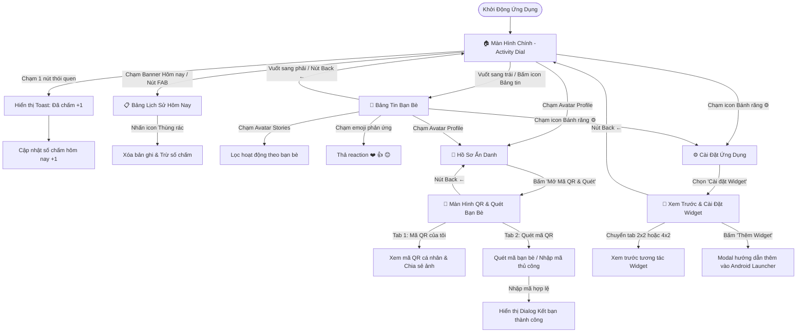

# Kế Hoạch & Kịch Bản Kiểm Thử Quy Trình Ứng Dụng (Workflow Test Guide)

Tài liệu này hướng dẫn chi tiết các kịch bản kiểm thử quy trình người dùng (User Workflows), kiểm thử điều hướng (Navigation Integration Tests) và quy trình tự động hóa kiểm thử (CI/CD Test Workflow) cho ứng dụng **Chăm**.

---

## 🧭 Bản Đồ Quy Trình Người Dùng (End-to-End User Flow)



---

## 🧪 Ma Trận Kịch Bản Kiểm Thử Quy Trình (Workflow Test Cases)

### Kịch Bản 1: Ghi Nhận Nhanh 1-Chạm & Quản Lý Lịch Sử (Core Logging Flow)
* **Mục tiêu:** Kiểm tra khả năng tạo bản ghi tức thì không cần form (LOG-03) và xóa bản ghi không có Undo (HIS-02, LOG-04).

| Bước | Hành động | Kết quả kỳ vọng | Trạng thái |
| :---: | :--- | :--- | :---: |
| 1.1 | Mở ứng dụng vào màn hình chính `ActivityDialPage`. | Hiển thị 19 nút thói quen trên 3 vòng quỹ đạo, thẻ tổng kết ngày hôm nay và nút tâm `+ CHẤM`. | Đạt |
| 1.2 | Chạm vào nút `☕ Cà phê` trên quỹ đạo trong (R1). | Nút nảy hiệu ứng co giãn (bounce scale); xuất hiện Toast `Đã chấm: Cà phê (+1 chấm) — Đã lưu`; số chấm trên thẻ hôm nay tăng thêm 1. | Đạt |
| 1.3 | Chạm vào thẻ banner **"HÔM NAY"** hoặc nút tròn FAB đen ở góc dưới phải. | Mở `TodayLogsSheet` hiển thị danh sách các bản ghi của ngày hôm nay kèm giờ ghi nhận (ví dụ `14:30`). | Đạt |
| 1.4 | Nhấn biểu tượng thùng rác màu đỏ cạnh bản ghi vừa tạo. | Bản ghi bị xóa ngay lập tức; tổng số chấm hôm nay được tính lại tương ứng; không có nút Undo. | Đạt |

---

### Kịch Bản 2: Vuốt Chuyển Bảng Tin & Tương Tác Xã Hội (Feed & Reactions Flow)
* **Mục tiêu:** Kiểm tra cử chỉ vuốt ngang giữa Trang Chủ và Bảng Tin (SOC-04).

| Bước | Hành động | Kết quả kỳ vọng | Trạng thái |
| :---: | :--- | :--- | :---: |
| 2.1 | Tại màn hình chính, đặt ngón tay và vuốt từ phải sang trái (Swipe Left). | Màn hình trượt mượt mà sang `FeedPage` (Bảng tin hoạt động xã hội). | Đạt |
| 2.2 | Quan sát thanh Stories trên đầu Bảng tin và chạm vào người dùng `Minh Thư`. | Danh sách bảng tin lọc chỉ hiển thị các hoạt động của `Minh Thư`. | Đạt |
| 2.3 | Chạm vào emoji `❤️` trên thẻ hoạt động. | Emoji được đánh dấu nổi bật với nền hồng nhạt (`#FADCD9`); chạm lại lần nữa để hủy thả reaction. | Đạt |
| 2.4 | Vuốt từ trái sang phải (Swipe Right) hoặc chạm nút `←` trên Header. | Trượt mượt mà quay trở lại màn hình chính `ActivityDialPage`. | Đạt |

---

### Kịch Bản 3: Kết Nối Bạn Bè Bằng QR & Quét Mã (Friend Connection Flow)
* **Mục tiêu:** Kiểm tra hiển thị QR cá nhân và luồng quét QR kết bạn hai chiều (SOC-01).

| Bước | Hành động | Kết quả kỳ vọng | Trạng thái |
| :---: | :--- | :--- | :---: |
| 3.1 | Tại màn hình chính hoặc bảng tin, chạm vào icon Avatar tròn màu nâu đỏ. | Mở `UserProfileSheet` hiển thị thông tin ẩn danh và mã mời `CHAM-XXXXXX`. | Đạt |
| 3.2 | Chạm vào nút **"Mở Mã QR & Quét Bạn Bè"**. | Điều hướng vào màn hình `AddQrPage` với tab mặc định là **"Mã QR của tôi"**. | Đạt |
| 3.3 | Kiểm tra các thành phần trên thẻ QR. | Thấy Avatar cá nhân, tên `Hà My (Tôi)`, username `@hamy_cham`, mã QR dot-matrix kèm logo Chấm ở tâm, nút `Chia sẻ ảnh` và `Lưu vào máy`. | Đạt |
| 3.4 | Chạm tab **"Quét mã QR"**. | Chuyển sang giao diện máy quét với khung nhắm góc bo tròn và tia laser quét chuyển động lên xuống. | Đạt |
| 3.5 | Nhấn nút **"Bật đèn"**. | Nút đổi trạng thái thành **"Tắt đèn"** với màu nhấn cam sáng. | Đạt |
| 3.6 | Nhấn nút **"Nhập mã"**, gõ `CHAM-7K9M2P` và bấm **"Kết nối bạn bè"**. | Xuất hiện Dialog `Tìm thấy bạn bè!` cho phép xác nhận kết bạn. | Đạt |
| 3.7 | Bấm nút `←` ở góc trên bên trái. | Quay lại màn hình trước đó. | Đạt |

---

### Kịch Bản 4: Cấu Hình Widget Màn Hình Chính (Widget Setup Flow)
* **Mục tiêu:** Kiểm tra giao diện xem trước và cấu hình widget ngoài màn hình chính (WID-01).

| Bước | Hành động | Kết quả kỳ vọng | Trạng thái |
| :---: | :--- | :--- | :---: |
| 4.1 | Tại thanh Header, chạm vào biểu tượng bánh răng cài đặt `⚙️`. | Hộp thoại cài đặt mở ra, có mục **"Cài đặt Widget (2×2, 4×2)"**. | Đạt |
| 4.2 | Chạm vào mục **"Cài đặt Widget"**. | Điều hướng vào màn hình `WidgetSelectionPage`. | Đạt |
| 4.3 | Chạm tab **"Nhỏ (2×2)"** và **"Vừa (4×2)"**. | Chuyển đổi mượt mà giữa bản xem trước widget 2x2 (chấm log nhanh 1 nút) và 4x2 (thống kê danh sách thói quen & chuỗi streak). | Đạt |
| 4.4 | Chạm nút **"Thêm Widget"**. | Hiển thị bảng hướng dẫn từng bước ghim widget ra màn hình chính Android. | Đạt |
| 4.5 | Bấm nút `←`. | Quay lại màn hình chính. | Đạt |

---

## 🤖 Thực Thi Kiểm Thử Tự Động (Automated Testing Execution)

Tất cả các bài kiểm thử tự động đã được lập trình đầy đủ bằng Flutter Test Framework.

### 1. Lệnh Chạy Toàn Bộ Test Suite
Di chuyển vào thư mục `mobile` và chạy:

```bash
cd mobile
flutter test
```

### 2. Chi Tiết Các Tệp Kiểm Thử Thành Phần
| Tệp kiểm thử | Phạm vi kiểm tra | Lệnh thực thi độc lập |
| :--- | :--- | :--- |
| [`main_navigation_test.dart`](file:///c:/Users/admin/StudioProjects/Cham-ActivityLogWithPeople/mobile/test/main_navigation_test.dart) | Kiểm thử vuốt ngang trái/phải và điều hướng QR/Widget | `flutter test test/main_navigation_test.dart` |
| [`activity_dial_test.dart`](file:///c:/Users/admin/StudioProjects/Cham-ActivityLogWithPeople/mobile/test/activity_dial_test.dart) | Kiểm thử 19 loại sự kiện trên 3 quỹ đạo & serialization | `flutter test test/activity_dial_test.dart` |
| [`add_qr_test.dart`](file:///c:/Users/admin/StudioProjects/Cham-ActivityLogWithPeople/mobile/test/add_qr_test.dart) | Kiểm thử tab Mã QR cá nhân, nút lưu/chia sẻ và máy quét | `flutter test test/add_qr_test.dart` |
| [`widget_selection_test.dart`](file:///c:/Users/admin/StudioProjects/Cham-ActivityLogWithPeople/mobile/test/widget_selection_test.dart) | Kiểm thử xem trước widget 2x2, 4x2 và modal hướng dẫn | `flutter test test/widget_selection_test.dart` |

---

## ⚙️ Tích Hợp Quy Trình CI/CD Tự Động (.github/workflows)

Để đảm bảo mọi Pull Request vào `main-onlymerge` đều được tự động chạy toàn bộ các bài kiểm thử giao diện và luồng điều hướng, tệp cấu hình GitHub Actions cho Mobile được thiết lập như sau:

Tạo tệp `.github/workflows/mobile.yml`:

```yaml
name: Mobile CI

on:
  push:
    branches: [ main-onlymerge ]
  pull_request:
    branches: [ main-onlymerge ]

jobs:
  test:
    name: Run Flutter Tests & Lints
    runs-on: ubuntu-latest

    steps:
      - name: Checkout Repository
        uses: actions/checkout@v4

      - name: Set up Flutter
        uses: subosito/flutter-action@v2
        with:
          channel: 'stable'
          cache: true

      - name: Install Dependencies
        working-directory: mobile
        run: flutter pub get

      - name: Analyze Project
        working-directory: mobile
        run: flutter analyze

      - name: Run Widget & Navigation Tests
        working-directory: mobile
        run: flutter test
```
